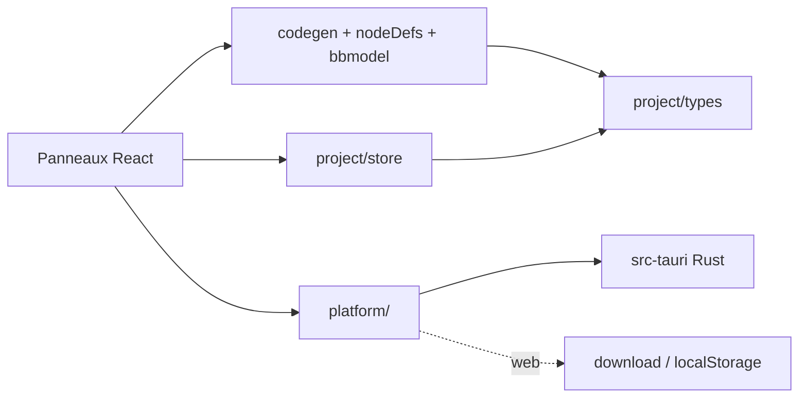
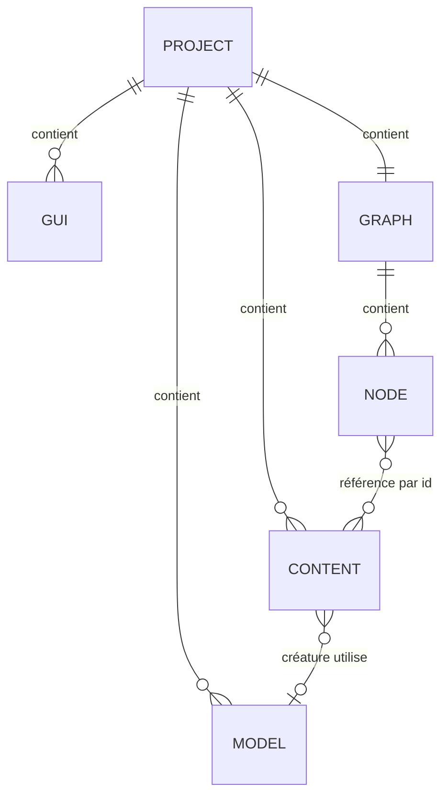

# Architecture Spine : Tessera v1

## Paradigme

**Noyau fonctionnel, coquille impérative.**

- **Noyau** (`src/project`, `src/codegen`, `src/nodes/nodeDefs.ts`, `src/modeler/bbmodel.ts`) : TypeScript pur. Il ne fait aucune entrée/sortie, ne dépend pas du DOM (sauf `paintTexture`), et se teste avec Vitest.
- **Coquille** :
  - côté front : l'interface React (`src/*/…Panel.tsx`) et l'adaptateur `src/platform` ;
  - côté natif : Rust/Tauri (`src-tauri/`), chargé des fichiers, des téléchargements et des processus.



Les dépendances vont dans le sens des flèches. `codegen` n'importe jamais React, le store ou `platform`.

## Invariants et règles

### AD-1 : Le Projet est la seule source de vérité [ADOPTED]
- **Binds:** tout le code.
- **Prevents:** que deux panneaux gardent chacun une copie divergente des données.
- **Rule:** toute modification passe par `useProject.getState().update(recipe)` (immer). L'état d'interface (sélection, panneau actif) vit dans `useUi` et n'est jamais sérialisé dans `tessera.json`.

### AD-2 : La génération de code est pure, à sens unique et déterministe
- **Binds:** FR-9, FR-10, FR-12, FR-13, FR-15, FR-16, FR-17.
- **Prevents:** une génération Java dupliquée en Rust, et des Builds différents à projet identique.
- **Rule:**
  - `buildMod(project): { files: ModFile[], diagnostics }` est l'unique producteur des fichiers du mod.
  - Pas de `Date.now()` ni de valeur aléatoire dans ce qui sort de `buildMod`. Les UUID FancyMenu sont dérivés des ids.
  - Le code Rust écrit les `ModFile` tels quels et ne génère jamais de code.

### AD-3 : Le Côté (serveur/client) est déclaré, jamais deviné [ADOPTED]
- **Binds:** FR-10 et FR-11.
- **Prevents:** qu'une classe client soit chargée sur un serveur dédié.
- **Rule:**
  - Chaque `NodeDef` déclare son `side`. Seul `codegen/logic.ts` place les gardes `isClientSide()`.
  - Le code commun n'atteint le code client que par `ModClient.openScreen(String)`.
  - Les classes `client/` sont annotées `Dist.CLIENT`.

### AD-4 : Le Contenu personnalisé est référencé par son id
- **Binds:** FR-7, FR-11, FR-12 et FR-13.
- **Prevents:** que renommer un objet casse les nœuds qui l'utilisent.
- **Rule:**
  - Un paramètre de nœud qui vise du Contenu personnalisé stocke `content:<id>`.
  - Le nom de registre (`registryName`, en minuscules et unique par type) est calculé au codegen par `contentRegistryNames(project)`, puis résolu en `<modid>:<registryName>`.
  - La saisie libre (`minecraft:diamond`) reste possible.

### AD-5 : Format sur disque versionné
- **Binds:** FR-2 et FR-4.
- **Prevents:** des projets illisibles d'une version de Tessera à l'autre, et un JSON gonflé par le base64.
- **Rule:**
  - Le dossier projet contient `tessera.json` (`format: 'tessera'`, `formatVersion: N`) et `assets/**/*.png`.
  - En mémoire, les images sont des data URL. La conversion se fait **uniquement** dans `platform/` (à l'écriture : data URL → fichier + chemin `asset:<chemin>` ; l'inverse à la lecture).
  - Tout changement de schéma incrémente `formatVersion` et ajoute une migration dans `project/migrate.ts`. Toute ouverture passe par `migrate()`.

### AD-6 : Un seul adaptateur Plateforme
- **Binds:** FR-1, FR-2, FR-4, FR-16 et FR-17.
- **Prevents:** que des composants appellent Tauri directement, ce qui casserait la version web et les tests.
- **Rule:**
  - Les composants n'utilisent que `platform` (`src/platform/index.ts`), qui choisit `tauri.ts` ou `web.ts` à l'exécution via `isTauri()`.
  - Seul `platform/tauri.ts` importe `@tauri-apps/*`.

### AD-7 : Chaîne de Build
- **Binds:** FR-17 et FR-16.
- **Prevents:** des Builds qui dépendent de la machine de l'utilisateur.
- **Rule:**
  - Le front appelle `invoke('build_mod', { modId, files })`.
  - Rust écrit les fichiers dans `app_data_dir/builds/<modid>/`, en supprimant les fichiers générés obsolètes mais en conservant `build/` et `.gradle/`.
  - Rust ajoute le wrapper Gradle embarqué (ressource Tauri), s'assure d'avoir un JDK 21 (celui du système s'il est en version 21, sinon Temurin 21 téléchargé dans `app_data_dir/jdk/`) et lance `gradlew build --console=plain` avec `JAVA_HOME`.
  - Le journal est émis ligne par ligne sur l'événement `build://log`, et le résultat sur `build://done` (`{ ok, jarPath }`).

### AD-8 : Versions épinglées en un seul endroit
- **Binds:** FR-16 et FR-17.
- **Prevents:** des incohérences de version entre `build.gradle`, le wrapper et le `mods.toml`.
- **Rule:** `src/codegen/versions.ts` est le seul endroit où écrire une version de Minecraft, NeoForge, ModDevGradle, Gradle ou foojay.

## Conventions

| Sujet | Convention |
|---|---|
| Identifiants internes | `nanoid(10)`, champ `id`, jamais réutilisé |
| Noms Java | Avec `pascal()` : `<Nom>Screen`, `<Nom>Item`, `<Nom>Entity`, `<Nom>Model`. Paquet `com.<modid>` |
| Noms de registre et fichiers de ressource | Avec `slug()` : minuscules, `_` |
| Diagnostics | `{ level: 'error' \| 'warning', message (français), nodeId? }`. Une erreur bloque le Build |
| Texte de l'interface | Français |
| Fichiers générés | En-tête « Généré par Tessera ». Seul `CustomCode.java` est modifiable |
| Erreurs Rust → front | `Result<T, String>` avec un message en français |

## Stack

| Nom | Version |
|---|---|
| Minecraft / NeoForge | 1.21.1 / 21.1.264 |
| ModDevGradle / Gradle / foojay | 2.0.148 / 9.2.1 / 1.0.0 |
| Java (mod et Build) | 21 |
| Tauri (CLI, API) | 2.12.x |
| React / TypeScript / Vite | 19 / 7 / 8 |
| Rust | stable |

## Structure de départ

```text
src/
  project/    types, defaults, store, migrate (noyau)
  codegen/    names, versions, logic, screens, content, fancymenu, modProject (noyau)
  modeler/ gui/ nodes/ code/ content/   panneaux (coquille)
  platform/   index, web, tauri (coquille)
src-tauri/
  src/        lib.rs (commandes), build.rs (Gradle/JDK), project.rs (fichiers)
  resources/gradle-wrapper/   gradlew, gradlew.bat, gradle/wrapper/*
```



## Correspondance PRD → architecture

| Exigence | Emplacement | Règles |
|---|---|---|
| FR-1 à FR-4 | `src-tauri/`, `platform/`, `project/migrate.ts` | AD-5, AD-6 |
| FR-5 à FR-7 | `modeler/`, `codegen/content.ts` | AD-2, AD-4 |
| FR-8 et FR-9 | `gui/`, `codegen/screens.ts`, `codegen/fancymenu.ts` | AD-2 |
| FR-10 et FR-11 | `nodes/`, `codegen/logic.ts` | AD-2, AD-3, AD-4 |
| FR-12 à FR-14 | `content/`, `codegen/content.ts` | AD-4, AD-5 |
| FR-15 et FR-16 | `code/`, `codegen/modProject.ts` | AD-2, AD-8 |
| FR-17 | `src-tauri/src/build.rs`, `platform/tauri.ts` | AD-7, AD-8 |

## Reporté

- **Signature et notarisation macOS, mise à jour automatique** : inutiles avant une distribution publique.
- **CI (GitHub Actions)** : à ajouter quand il y aura des contributeurs. Les tests passent déjà en local.
- **Lancement du client de test (FR-18)** : v1.1, sur la même chaîne qu'AD-7 avec `runClient`.
- **Réseau personnalisé (paquets)** : hors périmètre v1 (cf. PRD §5).
